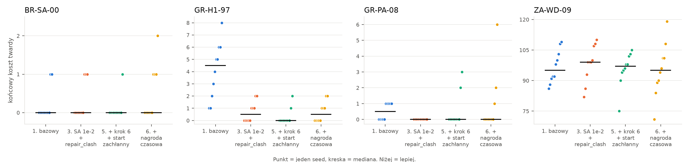

# LLM-Driven RL Hyper-Heuristic for School Timetabling

Selekcyjna hiperheurystyka dla problemu układania planów lekcji (benchmark XHSTT): selektor UCB sterowany uczeniem ze wzmocnieniem wybiera heurystyki lokalnego przeszukiwania, a o przyjęciu kandydatów decyduje symulowane wyżarzanie. Docelowo LLM będzie generował nowe heurystyki rozszerzające pulę operatorów w czasie działania solvera.

Projekt inżynierski (praca dyplomowa).

**Stan:** zrobione etapy 1–6 (parser, ewaluator zgodny z HSEval, ewaluacja przyrostowa, pula heurystyk, pętla solvera, selektor UCB) oraz optymalizacja wykonalności planu (#82). Integracja LLM (Etap 7) jest wstrzymana; framework eksperymentów (Etap 8) jest w trakcie.

## Jak działa solver

```
parser → rozwiązanie startowe → pętla lokalnego przeszukiwania → eksport XML (HSEval) + raport HTML
                                 │
                                 ├─ selektor UCB wybiera heurystykę dla bieżącego stanu
                                 ├─ heurystyka proponuje kandydata (nigdy nie zmienia wejścia)
                                 ├─ koszt kandydata liczony przyrostowo
                                 ├─ symulowane wyżarzanie decyduje o przyjęciu
                                 └─ nagroda (1 za poprawę, +0,1 za nowe najlepsze) wraca do UCB
```

- **Koszt** to para (naruszenia twarde, koszt miękki) porównywana leksykograficznie; wagi i funkcje kosztu pochodzą z XML-a instancji.
- **Selektor UCB** prowadzi osobne statystyki (Q, n) dla każdej heurystyki w każdym z 6 stanów: (plan wykonalny?, stagnacja niska/średnia/wysoka). Wybiera `argmax Q + c·sqrt(ln N / n)`, `c = 0.02`, Q aktualizowane średnią wykładniczą z `alpha = 0.02`.
- **Pula heurystyk** (`src/heuristics.py`): `move_random`, `move_best`, `swap`, `kempe_chain`, `repair_hard_violation`, `repair_clash`, `ruin_and_recreate`, `resource_reassign`, `split_resize`. Perturbacje (`small_perturbation`, `large_perturbation`) uruchamia sam solver po 3000 iteracjach bez poprawy.
- **Rozwiązanie startowe** domyślnie zachłanne (`build_greedy`): zajęcia od najtrudniejszych, na godziny z najmniejszą liczbą kolizji.
- **Symulowane wyżarzanie** startuje od temperatury 1% kosztu startowego. Z limitem czasu stygnie według zegara, bez niego według numeru iteracji — wtedy przebieg jest w pełni powtarzalny z seeda.

Szczegóły decyzji i specyfikacja: `CLAUDE.md`.

## Wyniki

Plany wykonalne (bez żadnego naruszenia twardego) na instancjach bliskich wykonalności, 10 seedów × 120 s:

| instancja | konfiguracja bazowa | **obecna domyślna** |
|---|---|---|
| BR-SA-00 | 8/10 | **9/10** |
| GR-H1-97 | 0/10 | **8/10** |
| GR-PA-08 | 5/10 | **8/10** |
| razem | 13/30 | **25/30** |

Na GR-H1-97 poprawa jest istotna statystycznie (test Wilcoxona z poprawką Bonferroniego). ZA-WD-09 (~95 kolizji) pozostaje poza zasięgiem w 120 s. Analiza: PR #83 i issue #82.



Pozostałe wykresy (zbieżność, udział heurystyk, akceptacja, porównanie selektorów) są w `docs/wyniki/`.

## Development

Nad zmianami pracujemy na swoich branchach. Branch nazywamy według schematu:

```
issue#<issue>[-opis]
```

> [!TIP]
> **Zadania w VS Code (Tasks)**:
> Jeśli korzystasz z VS Code, wszystkie opisane poniżej komendy (instalacja środowiska, uruchamianie solvera, testy, lintery) możesz uruchamiać wygodnie z poziomu edytora.
> Aby to zrobić, otwórz menu `Terminal` -> `Run Task...` (lub użyj skrótu klawiszowego `Ctrl+Shift+B` / `Cmd+Shift+B`) i wybierz odpowiednie zadanie z listy.

Do zarządzania zależnościami i środowiskiem w Pythonie używamy narzędzia `uv`.

### Uruchomienie i synchronizacja projektu

* **Synchronizacja środowiska (instalacja zależności)**:
  ```bash
  uv sync
  ```
* **Uruchomienie solvera** (domyślnie UCB + SA + start zachłanny):
  ```bash
  uv run python run_solver.py --list                          # wypisz dostępne instancje
  uv run python run_solver.py GR-PA-08                        # 30 000 iteracji, seed 0 — powtarzalne
  uv run python run_solver.py GR-PA-08 --time-limit 120       # limit czasu zamiast liczby iteracji
  uv run python run_solver.py GR-PA-08 --iterations 50000 --seed 1
  ```
  Wynik: `output/<id>_solution.xml` (format dla HSEval) i `output/<id>_timetable.html` (plan + rozbicie kosztu).

  Najważniejsze opcje: `--selector ucb|epsilon-greedy|random`, `--construct greedy|naive`,
  `--sa-t0-factor 0.01` (temperatura startowa jako ułamek kosztu startowego).

  > [!IMPORTANT]
  > **Kryterium akceptacji: zawsze symulowane wyżarzanie (`--acceptance sa`, domyślne).** LAHC
  > (`--acceptance lahc`) to stare kryterium z etapu przejściowego, zachowane tylko jako opcja do
  > porównań i odtworzenia wcześniejszych wyników — nie używamy go w nowych eksperymentach.
* **Eksperymenty porównawcze** (`experiments.py`; wyniki CSV w `data/results/`, logi JSONL w `data/logs/` — oba katalogi nie trafiają do repozytorium):
  ```bash
  # macierz instancje × selektory × kryteria akceptacji × seedy, równolegle
  uv run python experiments.py --instances GR-H1-97 GR-PA-08 ZA-WD-09 BR-SA-00 --seeds 0 1 2 3 4 \
      --selectors random ucb --time-limit 120 --workers 6 \
      --output data/results/moj_eksperyment.csv --log-dir data/logs/moj_eksperyment

  # konfiguracja sprzed optymalizacji wykonalności (issue #82), jedną flagą
  uv run python experiments.py --preset bazowy ...

  # raport: wykresy (PNG + PDF + CSV) i summary.md z testem Wilcoxona
  uv run python scripts/report_experiment.py --csv data/results/moj_eksperyment.csv \
      --log-dir data/logs/moj_eksperyment --out-dir data/results/report_moj_eksperyment

  # porównanie konfiguracji z kilku eksperymentów
  uv run python scripts/compare_experiments.py --out-dir data/results/porownanie \
      --group "A=data/results/a.csv:data/logs/a:sa" --group "B=data/results/b.csv:data/logs/b:sa"
  ```
  Uruchamiaj najwyżej tyle workerów, ile masz rdzeni fizycznych — przy limicie czasu wynik zależy od
  prędkości maszyny, więc porównuj tylko przebiegi z jednego eksperymentu.

  Każdy przebieg zapisuje w logu parametry (`run_config`), migawki statystyk UCB (`selector_state`: Q i n
  per stan i heurystyka), nowe najlepsze rozwiązania, rozbicie kosztu na typy ograniczeń oraz w CSV
  pełny opis kryterium akceptacji (`acceptance_detail`). Skrót `sa` w kolumnie `acceptance` oznaczał
  przed 18.10.2026 temperaturę startową 1e-3, a od tej daty 1e-2.
* **Uruchomienie przepływu (workflow) za pomocą Snakemake**:
  Potok automatycznie wykrywa wszystkie pliki instancji `.xml` w katalogu `data/raw/` (z wyłączeniem pustych plików i szablonu `instance.xml`), uruchamia dla nich solver równolegle, a na koniec generuje zbiorcze raporty podsumowujące koszty rozwiązań (`summary.csv` oraz `summary.md` w `data/results/`).

  Uruchomienie z domyślnymi parametrami (30 000 iteracji, seed=0):
  ```bash
  uv run snakemake --cores all
  ```

  Konfiguracja parametrów obliczeń za pomocą zmiennych środowiskowych (np. szybki test na 500 iteracji):
  * **Windows (PowerShell)**:
    ```powershell
    $env:SOLVER_ITERATIONS="500"; uv run snakemake --cores all
    ```
  * **Linux / macOS**:
    ```bash
    SOLVER_ITERATIONS=500 uv run snakemake --cores all
    ```

### Testowanie i jakość kodu

Przed wykonaniem commita lub pusha warto sprawdzić kod za pomocą poniższych poleceń:

* **Uruchomienie testów jednostkowych (pytest) z pokryciem**:
  ```bash
  uv run python -m pytest                   # pełny zestaw
  uv run python -m pytest -m "not slow"     # pomiń długie testy (~9 min)
  ```
  > **Uwaga:** używaj `python -m pytest`, nie `uv run pytest`. Brak sekcji `[build-system]` w `pyproject.toml` sprawia, że skrót `uv run pytest` nie dodaje katalogu głównego repo do `sys.path`, przez co import `src` się wywala.

  `tests/test_validator.py` wymaga uruchomionego Dockera z HSEval — bez niego te testy nie przechodzą.
* **Sprawdzenie typowania (mypy)**:
  ```bash
  uv run mypy src/
  ```
* **Linter (ruff check)**:
  ```bash
  uv run ruff check src/
  ```
* **Automatyczne formatowanie kodu (ruff format)**:
  ```bash
  uv run ruff format src/
  ```

### Pre-commit hooks

W repozytorium skonfigurowane są pre-commit hooki, które automatycznie sprawdzają poprawność kodu (Ruff, Mypy) oraz nazwę brancha i format wiadomości commitów.

* **Instalacja hooków w Git (wymagane raz na start)**:
  ```bash
  uv run pre-commit install --hook-type pre-commit --hook-type commit-msg
  ```

* **Format wiadomości commitów**:
  Stosujemy [Conventional Commits](https://www.conventionalcommits.org/), np.:
  ```
  feat: add UCB selector
  fix: correct deviation formula for LimitIdleTimesConstraint
  docs: update flow diagram
  refactor: split evaluator_ref.py into package
  chore: remove dead config.yaml
  ```

* **Ręczne uruchomienie hooków na wszystkich plikach**:
  ```bash
  uv run pre-commit run --all-files
  ```

### Struktura projektu

```
run_solver.py              — punkt wejścia CLI: rozwiązuje jedną instancję (UCB + SA)
experiments.py             — macierz eksperymentów: instancje × selektory × akceptacja × seedy → CSV + logi JSONL
Snakefile                  — potok: solver na data/raw/*.xml → data/results/summary.{csv,md}
pyproject.toml             — konfiguracja projektu: pytest, mypy, ruff, zależności (uv)

src/                       — pakiet domenowy (flat layout; import src.model itd.)
  model.py                 — dataclassy XHSTT: Instance, Event, Constraint, Solution, …
  parser.py                — parser XML archiwum XHSTT → list[Instance]
  construct.py             — rozwiązanie startowe: build_greedy (unika kolizji) i build_initial (losowe)
  evaluator_ref/           — ewaluator kosztu (referencyjny, pełna ewaluacja, zgodny z HSEval)
    _cache.py              — @cache dla statycznych danych per instancja (grupy, czasy, valid starts)
    occurrences.py         — Occurrence, resolve_occurrences, occupancy_index
    constraints.py         — _evaluate_*_constraint dla typów XHSTT + dispatch
    __init__.py            — fasada: evaluate_cost_components, total_cost, re-eksporty
  cost.py                  — Cost(infeasibility, objective), rozbicie kosztu na typy ograniczeń
  evaluation_index.py      — statyczny indeks: które ograniczenia zależą od danego zdarzenia/zasobu
  incremental.py           — ewaluacja przyrostowa z transakcjami (IncrementalEvaluator)
  moves.py                 — ruchy elementarne (przesunięcie, zamiana, łańcuch Kempego, perturbacje, …)
  heuristics.py            — pula heurystyk, kontrakt apply(solution, instance, rng)
  selectors.py             — selektory heurystyk: UCB (kontekstowy), epsilon-greedy, losowy
  acceptance.py            — kryteria akceptacji: symulowane wyżarzanie (AutoSA), LAHC
  lahc.py                  — pętla lokalnego przeszukiwania (run_lahc; nazwa historyczna, akceptacja jest wymienna)
  solve_log.py             — logi przebiegu w JSON Lines
  validator.py             — uruchomienie HSEval (KHE) do zewnętrznej weryfikacji rozwiązań
  xml_writer.py            — eksport Solution → XML XHSTT (format dla HSEval)
  html_report/             — raport HTML: siatka planu i szczegóły oceny ograniczeń
  assets/                  — zasoby statyczne html_report (fonts.css, timetable.css)

data/
  xhstt2014/               — archiwum XHSTT-2014 (25 instancji, Git LFS)
  raw/                     — pojedyncze pliki instancji XML wykrywane przez Snakefile
  results/                 — wyniki eksperymentów i raporty (poza repo, oprócz summary.{csv,md})
  logs/                    — logi JSONL przebiegów eksperymentów (poza repo)

tests/
  fixtures/                — małe instancje XML: BrazilInstance1, ArtificialSudoku4x4
  test_acceptance.py       — testy kryteriów akceptacji (SA, LAHC)
  test_construct.py        — testy rozwiązań startowych
  test_cost.py             — testy modelu kosztu i rozbicia na typy ograniczeń
  test_delta.py            — testy ewaluacji przyrostowej pojedynczych zmian
  test_evaluator_ref.py    — testy ewaluatora kosztu (zgodność z HSEval)
  test_heuristics.py       — testy heurystyk (poprawność strukturalna, brak mutacji wejścia)
  test_html_report.py      — testy generowania raportu HTML
  test_incremental.py      — testy IncrementalEvaluator (w tym niezmiennik 10 000 ruchów, @slow)
  test_lahc.py             — testy pętli solvera (powtarzalność z seeda, stagnacja, nagroda)
  test_moves.py            — testy ruchów elementarnych
  test_parser.py           — testy parsera XHSTT
  test_solve_log.py        — testy logów przebiegu (akceptacja, parametry, statystyki UCB)
  test_validator.py        — testy integracji z HSEval (wymaga Dockera)
  test_xml_writer.py       — testy eksportu do XML

scripts/
  report_experiment.py     — raport eksperymentu: wykresy + summary.md z testem Wilcoxona
  compare_experiments.py   — raport porównujący konfiguracje z kilku eksperymentów
  plot_convergence.py      — krzywe zbieżności (najlepszy koszt twardy w czasie)
  plot_heuristic_usage.py  — udział wywołań heurystyk w trakcie przebiegu
  plot_acceptance.py       — odsetek akceptacji w czasie (i podział: lepszy / bez zmiany / gorszy)
  benchmark_incremental_evaluation.py — benchmark: pełna vs przyrostowa ewaluacja
  generate_summary.py      — generuje summary.csv/md z wynikami solvera (wywoływany przez Snakefile)
  check_branch_name.py     — hook pre-commit: walidacja nazwy brancha (issue#N-opis)
  check_commit_msg.py      — hook commit-msg: walidacja wiadomości commitu

docs/
  flow-ukladania-planu.md  — opis pipeline'u parsowanie→solver→eksport (dla pracy dyplomowej)
  wyniki/                  — kluczowe wykresy wyników eksperymentów (PR #83)
  superpowers/             — specyfikacje i plany implementacyjne poszczególnych etapów

archive/                   — stary parser ITC-2019, zachowany wyłącznie jako odniesienie historyczne
```

### Zarządzanie danymi (Git LFS)

Duże pliki z danymi (np. w folderze `data/`) są wersjonowane za pomocą narzędzia **Git LFS** (Large File Storage).

* **Instalacja Git LFS**:
  Przed rozpoczęciem pracy upewnij się, że masz zainstalowany Git LFS na swoim systemie (np. na Windows: `winget install github.gitlfs` lub pobierz instalator ze strony https://git-lfs.github.com/). Następnie zainicjalizuj go jednorazowo w swoim systemie komendą:
  ```bash
  git lfs install
  ```

* **Pobranie i wysyłanie danych**:
  Pliki śledzone przez Git LFS są pobierane i wysyłane automatycznie przy standardowych poleceniach Gita:
  ```bash
  git pull
  git push
  ```

* **Dodanie nowych dużych plików**:
  Wszelkie nowe pliki umieszczane w folderze `data/` zostaną automatycznie objęte wersjonowaniem LFS dzięki regułom zdefiniowanym w pliku `.gitattributes`. Wystarczy dodać je do commita w zwykły sposób:
  ```bash
  git add data/
  git commit -m "chore: add new data files"
  git push
  ```
